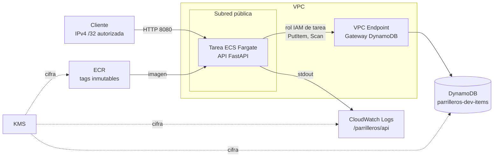

# parrilleros-taller6-infra

Taller 6: aplicación con base de datos administrada. Infraestructura para TI, segundo parcial. Equipo LOS PARRILLEROS.

Integrantes: Kathy Otero, Yuliana Martelo, Emanuel Buelvas, Andrés Vuelvas, Luis Ruz.

## Qué es

Una API REST en Python (FastAPI) que crea y lista elementos guardados en Amazon DynamoDB. Corre en un contenedor sobre ECS Fargate y accede a la base de datos con un rol IAM, sin claves de acceso en el código, la imagen ni el repositorio. Toda la infraestructura está definida con Terraform en AWS (us-east-1) y se valida con GitHub Actions, Trivy y Checkov.

## Arquitectura



Componentes principales:

- ECR: repositorio `parrilleros-dev-api` con tags inmutables, cifrado KMS y escaneo al publicar.
- ECS Fargate: un cluster, una definición de tarea (0.25 vCPU, 512 MB) y un servicio con una sola tarea y circuit breaker con rollback automático.
- DynamoDB: tabla `parrilleros-dev-items` (llave `id`, modo bajo demanda, cifrada con KMS, recuperación a un punto en el tiempo). También existe la tabla base `Empleados` con alarmas de CloudWatch y auditoría de CloudTrail.
- IAM: el rol de la tarea solo permite `dynamodb:PutItem` y `dynamodb:Scan` sobre la tabla de la API. Un rol de ejecución aparte solo descarga la imagen de ECR y escribe logs.
- Red: VPC propia, subred pública sin NAT ni balanceador, VPC Endpoint de tipo gateway para DynamoDB con política restringida al rol de la tarea, y un security group que solo admite el puerto 8080 desde una IPv4 /32.
- Observabilidad: logs de la API en CloudWatch, VPC Flow Logs, CloudTrail multirregión con logs en S3 (con bucket de access logs) y alarmas de errores y throttling de DynamoDB.

## Estructura del repositorio

```
app/                    API, Dockerfile, docker-compose para pruebas locales
terraform/              Infraestructura (compute, database, kms, logs, watch, red)
.github/workflows/      app.yml (API y Docker) e infra.yml (Terraform)
scripts/limpiar.ps1     Destrucción controlada y verificación
evidence/               Resultados de Trivy, Checkov, API y destrucción
```

## API

| Método | Ruta | Respuesta |
|--------|------|-----------|
| GET | `/health` | `200 {"status":"ok","version":"<commit>"}`. No consulta la base de datos. |
| POST | `/items` | Body `{"name": "...", "description": "..."}`. Responde `201` con `id` (UUID) y `created_at`. |
| GET | `/items?limit=50` | Lista de elementos (máximo 100), más recientes primero. |

Errores: `422` si la validación falla y `503` si DynamoDB no responde (queda en el log).

## CI/CD

Los workflows se separan por tipo de cambio:

- `app.yml` (cambios en `app/**`): construye la imagen con el SHA del commit, ejecuta Trivy sobre las dependencias y sobre la imagen (falla ante vulnerabilidades HIGH o CRITICAL) y guarda los reportes como artefacto.
- `infra.yml` (cambios en `terraform/**`): ejecuta `terraform fmt -check`, `terraform init -backend=false`, `terraform validate` y Checkov.

Ambos corren en cada push y pull request hacia `main`, con permisos de solo lectura (`contents: read`).

## Variables de Terraform

| Variable | Descripción | Valor por defecto |
|----------|-------------|-------------------|
| `project_name` | Prefijo de los recursos | `parrilleros` |
| `environment` | Ambiente (solo se admite `dev`) | `dev` |
| `aws_region` | Región de AWS | `us-east-1` |
| `deploy_api` | Activa el servicio ECS. Solo después de publicar la imagen en ECR. | `false` |
| `image_tag` | Tag inmutable de la imagen (SHA del commit). No se admite `latest`. | `bootstrap` |
| `allowed_client_cidr` | IPv4 pública de quien prueba, con `/32`. No se admite `0.0.0.0/0`. | `127.0.0.1/32` |

Todos los recursos llevan las etiquetas `Team = LOS PARRILLEROS`, `Project = parrilleros-taller6` y `Environment = dev`.

Variables de entorno del contenedor: `TABLE_NAME`, `AWS_REGION`, `APP_VERSION` (el tag de la imagen) y `LOG_LEVEL`.

## Despliegue

Todos los comandos están escritos para PowerShell (Windows). Requisitos: PowerShell 5.1 o superior, Git, Terraform 1.5 o superior, AWS CLI con una sesión activa (`aws login --profile parrilleros`), Docker y Trivy.

1. Crear la infraestructura base, con la API apagada:

```powershell
cd terraform
terraform init
terraform apply
```

2. Construir, analizar y publicar la imagen con el SHA del commit como tag:

```powershell
$TAG  = git rev-parse HEAD
$REPO = terraform output -raw api_ecr_repository_url

docker build -t "${REPO}:${TAG}" ../app
trivy image --severity HIGH,CRITICAL --exit-code 1 "${REPO}:${TAG}"

aws ecr get-login-password --region us-east-1 | docker login --username AWS --password-stdin $REPO.Split('/')[0]
docker push "${REPO}:${TAG}"
```

3. Activar la API con la imagen publicada y tu IPv4 pública:

```powershell
$MI_IP = (Invoke-RestMethod https://checkip.amazonaws.com).Trim()

terraform apply `
  -var "deploy_api=true" `
  -var "image_tag=$TAG" `
  -var "allowed_client_cidr=$MI_IP/32"
```

Si la IP o el tag son los valores por defecto, Terraform se niega a crear el servicio.

## Acceso y pruebas

La API no tiene URL pública estable: se expone por HTTP en el puerto 8080 en la IP pública de la tarea, y solo responde a la IPv4 autorizada. Para obtener la IP de la tarea:

```powershell
$TASK = aws ecs list-tasks --cluster parrilleros-dev --query 'taskArns[0]' --output text
$ENI  = aws ecs describe-tasks --cluster parrilleros-dev --tasks $TASK `
  --query "tasks[0].attachments[0].details[?name=='networkInterfaceId'].value" --output text
$IP   = aws ec2 describe-network-interfaces --network-interface-ids $ENI `
  --query 'NetworkInterfaces[0].Association.PublicIp' --output text
```

Luego se prueban los tres endpoints y la validación:

```powershell
$BASE = "http://${IP}:8080"

# Health
Invoke-RestMethod "$BASE/health"

# Crear un elemento (201)
$item = Invoke-RestMethod -Method Post -Uri "$BASE/items" -ContentType 'application/json' `
  -Body '{"name":"Prueba","description":"creado desde PowerShell"}'
$item

# Consultarlo en la lista
Invoke-RestMethod "$BASE/items" | Where-Object { $_.id -eq $item.id }

# Cuerpo inválido: debe devolver 422
try {
  Invoke-RestMethod -Method Post -Uri "$BASE/items" -ContentType 'application/json' -Body '{"name":""}'
} catch {
  $_.Exception.Response.StatusCode.value__
}
```

También se puede usar `app/requests.http` con la extensión REST Client de VS Code, o `app/test_api.sh` desde Git Bash o WSL.

Para probar sin AWS: `cd app; docker compose up -d --build` levanta la API con DynamoDB Local (las credenciales `local/local` del compose son falsas). Con `$env:API_PORT = "8088"` se cambia el puerto si el 8080 está ocupado.

## Seguridad

- Sin credenciales en el repositorio: la API usa la cadena de credenciales de boto3, que en ECS toma el rol IAM de la tarea. Los archivos `*.tfvars`, `*.tfstate` y `.env` están en `.gitignore`.
- Mínimo privilegio: la tarea solo puede hacer `PutItem` y `Scan` sobre su tabla. Se eligieron esos dos permisos porque son exactamente las operaciones de `POST /items` y `GET /items`. La política del VPC Endpoint aplica la misma restricción en la red.
- Imagen: Alpine multi-stage, usuario no root (UID 10001), sin header `Server`, `HEALTHCHECK` incluido. En ECS corre con sistema de archivos raíz de solo lectura, sin privilegios y sin capabilities.
- Imágenes inmutables: ECR rechaza reutilizar un tag, y Terraform rechaza `latest`.
- Cifrado: DynamoDB, ECR, CloudWatch Logs y CloudTrail usan claves KMS con rotación. Los buckets de S3 bloquean acceso público y exigen TLS.
- Control de costos: DynamoDB bajo demanda, una sola tarea Fargate de 0.25 vCPU, sin NAT ni balanceador, y reglas de ciclo de vida en ECR y S3.

Hallazgos de Checkov aceptados (`#checkov:skip` en el código, cada uno con su justificación):

| Regla | Recurso | Motivo |
|-------|---------|--------|
| CKV_AWS_333 | Servicio ECS | Laboratorio sin NAT ni balanceador. La IP pública es necesaria para descargar de ECR y la entrada está limitada a una IPv4 /32. |
| CKV_AWS_144 | Buckets de S3 | Laboratorio de una sola región, sin recuperación entre regiones. El versionado está activo. |
| CKV_AWS_18 | Bucket de access logs | Es el destino final de los logs; registrar sus propias escrituras generaría logs recursivos. |
| CKV_AWS_145 | Bucket de access logs | El destino de S3 server access logging exige SSE-S3, según la documentación de AWS. |

## Evidencias

Carpeta `evidence/`:

| Archivo | Contenido |
|---------|-----------|
| `checkov-results.txt` | Checkov: 151 comprobaciones aprobadas, 0 fallidas y 5 omitidas (las justificadas arriba) |
| `trivy-results.txt` | Trivy sobre la imagen: 0 vulnerabilidades HIGH o CRITICAL |
| `api-health.json` | Respuesta de `/health`; la versión corresponde al SHA del commit desplegado |
| `api-post.json`, `api-get.json` | Elemento creado y consultado en la API desplegada en AWS |
| `limpieza-preparacion.txt` | Preparación previa a la destrucción |
| `terraform-destroy.txt` | Destrucción de 50 recursos |
| `verificacion-limpieza.txt` | Confirmación de AWS de que los recursos ya no existen |

Las ejecuciones de los workflows están en la pestaña Actions del repositorio. Los reportes JSON de Trivy se guardan como artefacto `reportes-seguridad-api`.

Demostración de un cambio de aplicación: se modifica `app/`, el workflow construye y analiza la imagen, se publica con el nuevo SHA y se aplica Terraform con `image_tag=<nuevo SHA>`. `/health` devuelve el nuevo SHA en el campo `version`.

Demostración de un cambio de infraestructura: se modifica algún archivo de `terraform/`, el workflow ejecuta `fmt`, `validate` y Checkov, y luego se aplica con `terraform apply`.

Rollback: volver a aplicar con el `image_tag` anterior. Además, el circuit breaker del servicio ECS revierte solo si la nueva tarea no llega a estado saludable.

## Destruir la infraestructura

Los buckets de logs tienen `prevent_destroy`, por lo que `terraform destroy` directo falla. El script `scripts/limpiar.ps1` (PowerShell) hace la destrucción en pasos revisables:

```powershell
./scripts/limpiar.ps1 -Paso Preparar            # genera el plan de preparación (no cambia AWS)
./scripts/limpiar.ps1 -Paso AplicarPreparacion  # apaga la API y habilita la limpieza
./scripts/limpiar.ps1 -Paso PlanDestruccion     # plan de destrucción, para revisar
./scripts/limpiar.ps1 -Paso Destruir            # aplica la destrucción
./scripts/limpiar.ps1 -Paso Verificar           # confirma con AWS que no queda nada
```

El script está escrito para la cuenta del laboratorio y el usuario `parrilleros-deploy`, y se niega a correr con otra identidad. Las claves KMS quedan en estado `PendingDeletion` durante 30 días, y el usuario de despliegue y sus políticas no se eliminan porque se crearon fuera de Terraform. Si no se usa el script, hay que quitar `prevent_destroy` y activar `force_destroy` en los buckets y `force_delete` en ECR antes de ejecutar `terraform destroy`.

## Decisiones y limitaciones

Decisiones:

- ECS Fargate sin balanceador ni NAT para mantener el costo bajo; el acceso se restringe a una IPv4 /32.
- `/health` no consulta DynamoDB, para que una falla transitoria de la base no haga que se reinicie el contenedor.
- La API se activa con `deploy_api` solo después de publicar y revisar la imagen.

Limitaciones:

- Los workflows validan (build, Trivy, `fmt`, `validate`, Checkov) pero no despliegan: la publicación en ECR y el `terraform apply` se ejecutan manualmente con un usuario IAM del laboratorio, no con OIDC.
- El estado de Terraform es local, sin backend remoto.
- Solo se admite el ambiente `dev`, y el acceso es HTTP sin TLS, no apto para producción.
- La IP pública de la tarea cambia cada vez que se reinicia.

Mejoras posibles: federación OIDC entre GitHub y AWS con despliegue automático desde Actions, backend remoto para el estado (S3 con bloqueo), balanceador con HTTPS y dominio propio, y fijar las versiones de Checkov y de las acciones en los workflows.